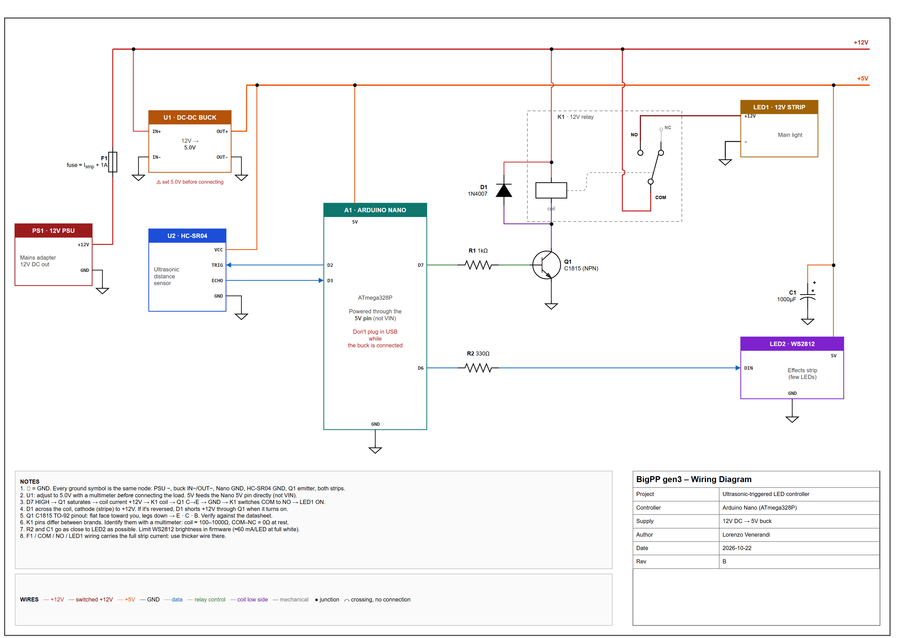
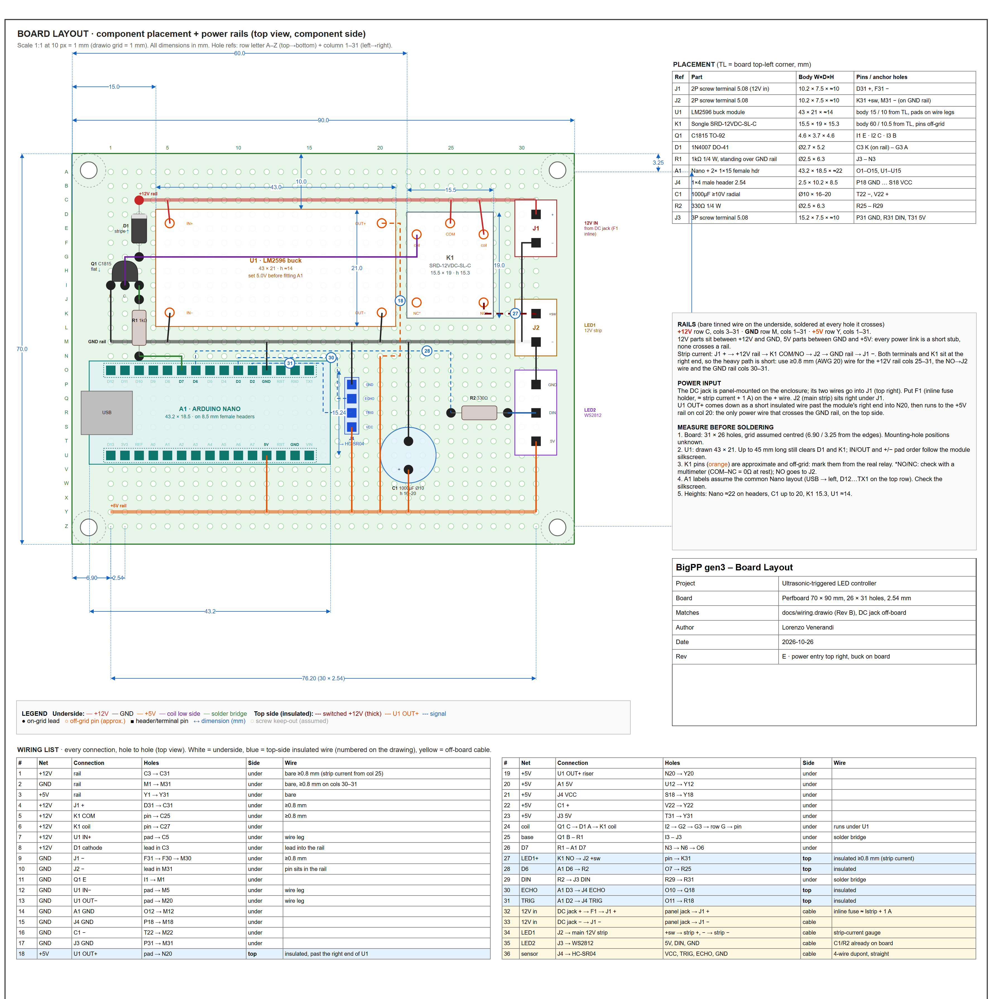

# BigPP gen3

An Arduino Nano controller that switches a 12V LED strip on and off without touching anything. You move your hand towards an HC-SR04 ultrasonic sensor. A small WS2812 ring fades in as your hand gets closer, as a preview, and when your hand reaches the trigger distance the main strip toggles through a relay.

## How it works

- **Off by default.** Nothing is lit.
- **Approach fade.** In the zone just in front of the trigger distance (15–30 cm by default), the WS2812 LEDs preview what's about to happen:
  - When the light is off, they brighten as you get closer and reach 100% at the trigger distance.
  - When the light is on, they dim down to 0% instead.
  - If you back away before reaching the trigger, they go back to where they were.
- **Toggle.** Reaching the trigger distance switches the light on or off. The relay K1 switches the main 12V strip at the same moment.
- **Re-arm.** After a toggle you have to step back out of the fade zone before the next toggle can happen. Without this, a hand held at the trigger distance would make it flicker on and off.
- **Turn-on animation.** When the light switches on, a comet with a fading tail runs around the ring, slowing down. Underneath it, a soft breathing amber glow fades in.

All of this is set in [src/config.h](src/config.h). Every value has a comment explaining it.

| Group | Main settings |
|---|---|
| Trigger | `TRIGGER_DISTANCE_CM`, `TRIGGER_CONFIRM` |
| Approach fade | `FADE_ZONE_CM`, `FADE_STEPS` (0 = smooth), `FADE_SLEW_MS` |
| Glow | `GLOW_HUE`, `GLOW_SAT`, `GLOW_BPM`, `GLOW_MIN`, `GLOW_PHASE`, `GLOW_HUE_DRIFT` |
| Turn-on animation | `INTRO_MS` (0 = off), `INTRO_TURNS`, `INTRO_TAIL`, `INTRO_HEAD_SAT`, `INTRO_REVERSE` |
| LEDs | `NUM_LEDS`, `WS_BRIGHTNESS`, `WS_MAX_MA` |
| Debug | `DEBUG_SERIAL`: prints distance, state, armed and level at 115200 baud |

## Build and flash

The project uses [PlatformIO](https://platformio.org/). FastLED is installed automatically.

```sh
pio run                    # build
pio run -t upload          # flash the Nano
pio device monitor         # serial output (115200)
```

> **Don't plug in USB while the buck converter is powering the board.** The Nano runs from the 5V rail through its 5V pin, so USB and the buck would be driving the same net. Flash with the 12V supply disconnected.

## Hardware

| Ref | Part | Notes |
|---|---|---|
| A1 | Arduino Nano (ATmega328P) | on 2× 1×15 female headers |
| U1 | LM2596 buck module, 12V → 5V | **set it to 5.0V before connecting anything** |
| U2 | HC-SR04 ultrasonic sensor | off-board, on header J4 |
| K1 | Songle SRD-12VDC-SL-C relay | switches the main strip |
| Q1 | C1815 NPN transistor | drives the relay coil |
| D1 | 1N4007 | flyback diode across the coil |
| R1 / R2 | 1 kΩ / 330 Ω | Q1 base / WS2812 data line |
| C1 | 1000 µF ≥10V | bulk capacitor for the WS2812 |
| LED1 | 12V LED strip | the main light |
| LED2 | WS2812 ring, 8 LEDs | the effects |
| F1 | inline fuse, ≈ strip current + 1 A | on the + wire from the DC jack |
| J1–J3 | 5.08 mm screw terminals | 12V in, LED1, LED2 |

### Wiring diagram



Source file: [docs/wiring.drawio](docs/wiring.drawio)

- **Power:** a 12V supply feeds the relay and main strip directly. The buck converter makes 5V for the Nano (through its **5V pin, not VIN**), the sensor and the WS2812.
- **Relay drive:** D7 goes through R1 to the base of Q1. When D7 goes high, Q1 switches the relay coil's low side to ground. D1 sits across the coil with its stripe (cathode) towards +12V, to absorb the voltage spike when the coil turns off.
- **Signals:** sensor TRIG on D2, ECHO on D3. WS2812 data on D6 through R2. C1 sits across the WS2812's 5V supply.
- **Shared ground:** every ground symbol in the diagram is the same connection.

### Board layout



Source file: [docs/board-layout.drawio](docs/board-layout.drawio)

The board is a **70 × 90 mm perfboard with 31 × 26 holes at 2.54 mm**, drawn 1:1 (10 px = 1 mm). Holes are referenced as row letter + column number, for example `O6` is the Nano's D7 pin.

- **Three bare-wire rails on the underside:** **+12V on row C**, **GND on row M** and **+5V on row Y**.
  - The 12V parts (relay, Q1/D1/R1, buck input, J1/J2) sit between the +12V and GND rails.
  - The 5V parts (Nano, J3, J4, C1) sit between the GND and +5V rails.
  - That way every power connection is a short straight link to the rail next to it, and no power wire crosses a rail.
- **Power entry top right:** 12V comes in on J1 from a panel-mounted DC jack, with F1 inline on the + wire. The main strip connects on J2, right below it. The heavy-current path stays at the right edge of the board: J1 → +12V rail → relay → J2 → GND rail.
- **Top-side wires:** five connections can't be routed underneath without crossing, so they're insulated wires on the component side:
  - the buck's 5V output down into the 5V area,
  - relay NO to J2 (thick wire),
  - D6 to R2,
  - D2 and D3 to the sensor header.
- **Wiring list:** the table at the bottom of the drawing lists all 36 connections hole to hole.

Check these against your real parts before soldering. They're marked in orange on the drawing:

- the relay's pin positions, and which side is NO/NC,
- the buck module's pad order,
- the Nano's pin labels (against its silkscreen),
- where the board's mounting holes are.

## Repository layout

```
src/main.cpp           firmware: sensor, toggle/re-arm logic, fade, glow, turn-on animation
src/config.h           every pin and tuning parameter
docs/wiring.drawio     wiring diagram (rendered: docs/img/wiring.png)
docs/board-layout.drawio  perfboard placement + power rails + wiring list (rendered: docs/img/board-layout.png)
```
